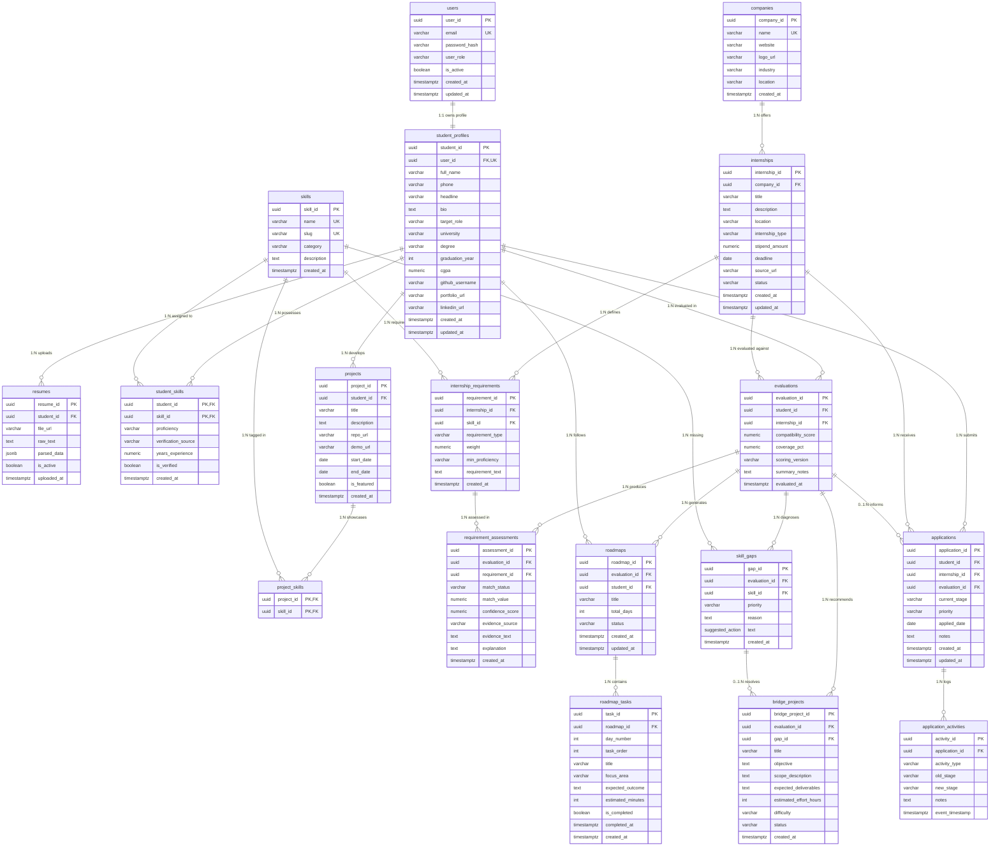

# PathForge Entity-Relationship (ER) Diagram & Data Dictionary

## 1. Overview & Architectural Domains

The PathForge relational database schema is structured into 6 interconnected functional domains comprising 18 tables:
1. **Identity & Authentication**: `users`, `student_profiles`, `resumes`
2. **Skills & Competency Taxonomy**: `skills`, `student_skills`, `projects`, `project_skills`
3. **Internship Opportunities**: `companies`, `internships`, `internship_requirements`
4. **Compatibility Engine & Diagnostics**: `evaluations`, `requirement_assessments`, `skill_gaps`
5. **Actionable Preparation**: `bridge_projects`, `roadmaps`, `roadmap_tasks`
6. **Application Tracking**: `applications`, `application_activities`

---

## 2. Mermaid Entity-Relationship Diagram

---

## 3. Detailed Data Dictionary

### 3.1 Entity Cardinalities & Foreign Key Relationships

| Parent Entity | Relationship | Child Entity | Cardinality | Foreign Key Column | On Delete Action |
| :--- | :---: | :--- | :---: | :--- | :--- |
| `users` | 1:1 | `student_profiles` | One to Exactly One | `student_profiles.user_id` | `CASCADE` |
| `student_profiles` | 1:N | `resumes` | One to Zero-or-Many | `resumes.student_id` | `CASCADE` |
| `student_profiles` | M:N | `skills` (via `student_skills`) | Many to Many | `student_skills.student_id` | `CASCADE` |
| `skills` | M:N | `student_profiles` | Many to Many | `student_skills.skill_id` | `RESTRICT` |
| `student_profiles` | 1:N | `projects` | One to Zero-or-Many | `projects.student_id` | `CASCADE` |
| `projects` | M:N | `skills` (via `project_skills`) | Many to Many | `project_skills.project_id` | `CASCADE` |
| `skills` | M:N | `projects` | Many to Many | `project_skills.skill_id` | `RESTRICT` |
| `companies` | 1:N | `internships` | One to Zero-or-Many | `internships.company_id` | `RESTRICT` |
| `internships` | 1:N | `internship_requirements` | One to One-or-Many | `internship_requirements.internship_id` | `CASCADE` |
| `skills` | 1:N | `internship_requirements` | One to Zero-or-Many | `internship_requirements.skill_id` | `SET NULL` |
| `student_profiles` | 1:N | `evaluations` | One to Zero-or-Many | `evaluations.student_id` | `CASCADE` |
| `internships` | 1:N | `evaluations` | One to Zero-or-Many | `evaluations.internship_id` | `CASCADE` |
| `evaluations` | 1:N | `requirement_assessments` | One to One-or-Many | `requirement_assessments.evaluation_id` | `CASCADE` |
| `internship_requirements`| 1:N | `requirement_assessments` | One to Zero-or-Many | `requirement_assessments.requirement_id` | `CASCADE` |
| `evaluations` | 1:N | `skill_gaps` | One to Zero-or-Many | `skill_gaps.evaluation_id` | `CASCADE` |
| `skills` | 1:N | `skill_gaps` | One to Zero-or-Many | `skill_gaps.skill_id` | `RESTRICT` |
| `evaluations` | 1:N | `bridge_projects` | One to Zero-or-Many | `bridge_projects.evaluation_id` | `CASCADE` |
| `skill_gaps` | 1:N | `bridge_projects` | Zero-or-One to Many | `bridge_projects.gap_id` | `SET NULL` |
| `evaluations` | 1:N | `roadmaps` | One to Zero-or-Many | `roadmaps.evaluation_id` | `CASCADE` |
| `student_profiles` | 1:N | `roadmaps` | One to Zero-or-Many | `roadmaps.student_id` | `CASCADE` |
| `roadmaps` | 1:N | `roadmap_tasks` | One to Exactly 7 | `roadmap_tasks.roadmap_id` | `CASCADE` |
| `student_profiles` | 1:N | `applications` | One to Zero-or-Many | `applications.student_id` | `CASCADE` |
| `internships` | 1:N | `applications` | One to Zero-or-Many | `applications.internship_id` | `CASCADE` |
| `evaluations` | 1:N | `applications` | Zero-or-One to Many | `applications.evaluation_id` | `SET NULL` |
| `applications` | 1:N | `application_activities` | One to One-or-Many | `application_activities.application_id` | `CASCADE` |

---

## 4. Entity Attribute Constraints & Domain Rules

1. **User Authentication (`users`)**:
   - `email`: Enforces format consistency, guaranteed unique across the platform.
   - `user_role`: Restricts authorization scope to `STUDENT`, `MENTOR`, or `ADMIN`.
2. **Student Profile (`student_profiles`)**:
   - `user_id`: Unique foreign key enforcing strict 1:1 relationship with `users`.
   - `cgpa`: Constrained between $0.00$ and $10.00$.
   - `graduation_year`: Constrained between $2000$ and $2100$.
3. **Requirement Assessment (`requirement_assessments`)**:
   - `match_status`: Discriminates between `MATCHED`, `PARTIALLY_MATCHED`, `MISSING`, `NEEDS_VERIFICATION`.
   - `match_value`: Quantified contribution ($1.00$ for matched, $0.50$ for partial, $0.00$ for missing).
   - Composite uniqueness constraint: `UNIQUE (evaluation_id, requirement_id)` prevents duplicate assessments.
4. **Roadmap Structure (`roadmap_tasks`)**:
   - `day_number`: Constrained between $1$ and $30$ (standard default 7-day preparation sprint).
   - `task_order`: Sequential task index per day.
   - Composite uniqueness: `UNIQUE (roadmap_id, day_number, task_order)`.
5. **Application Lifecycle (`applications`)**:
   - `current_stage`: Strict state machine (`SAVED` → `RESEARCHING` → `PREPARING` → `READY_TO_APPLY` → `APPLIED` → `ASSESSMENT` → `INTERVIEW` → `OFFER` / `REJECTED` / `WITHDRAWN`).
   - `UNIQUE (student_id, internship_id)`: A student cannot duplicate active tracking entries for the same opportunity.

